[mwshumway.github.io/data/market_regime_id.pdf](https://mwshumway.github.io/data/market_regime_id.pdf)

In this paper, they mentioned student-t with PCA dimention reduction have a better persistent HMM. They ran the experiment on s&p 500. Their experiment setting is for every prediction t+1 it fits a new HMM and PCA based on the lag t-10 years features, and made decision based on the 12-day rolling median to decide to all-in or hold cash.

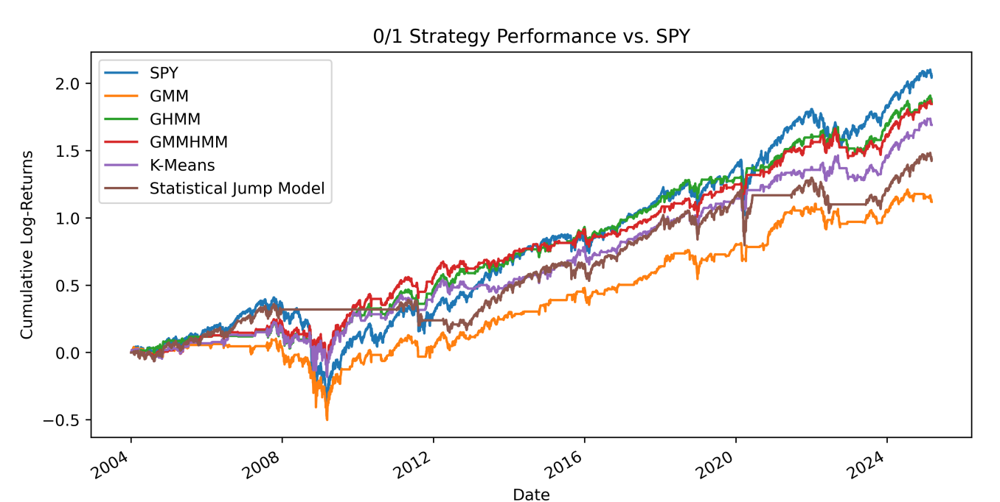

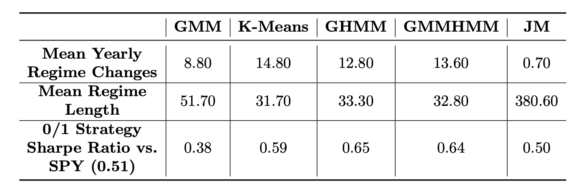

I tried to replicate the experiment setting, however, the refitting for every new trading day is too computationally expensive. I refit PCA and HMM every 63 trading days. For non refitting days, I ran 3 more EM step for my algorithm. This dramatically reduce the computation. Also, instead of the trailing 10 year fitting window, I only append new day but not drop the old data, so it that last few fit, it inlcudes more than 20 years of data. In this experiment, I was focusing on two regimes model.

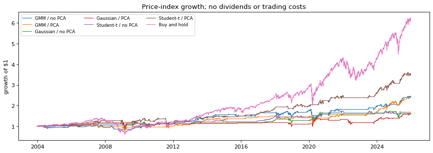

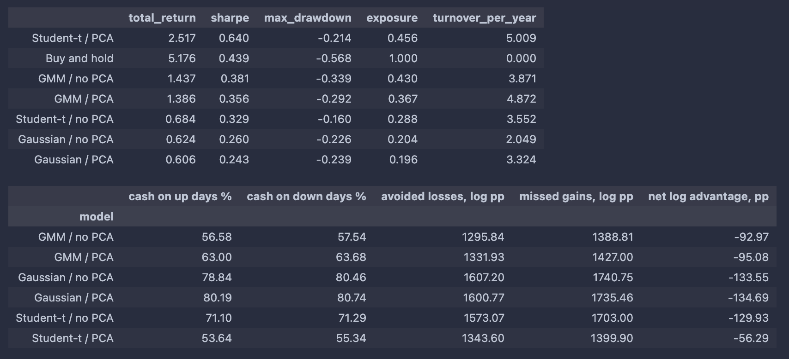

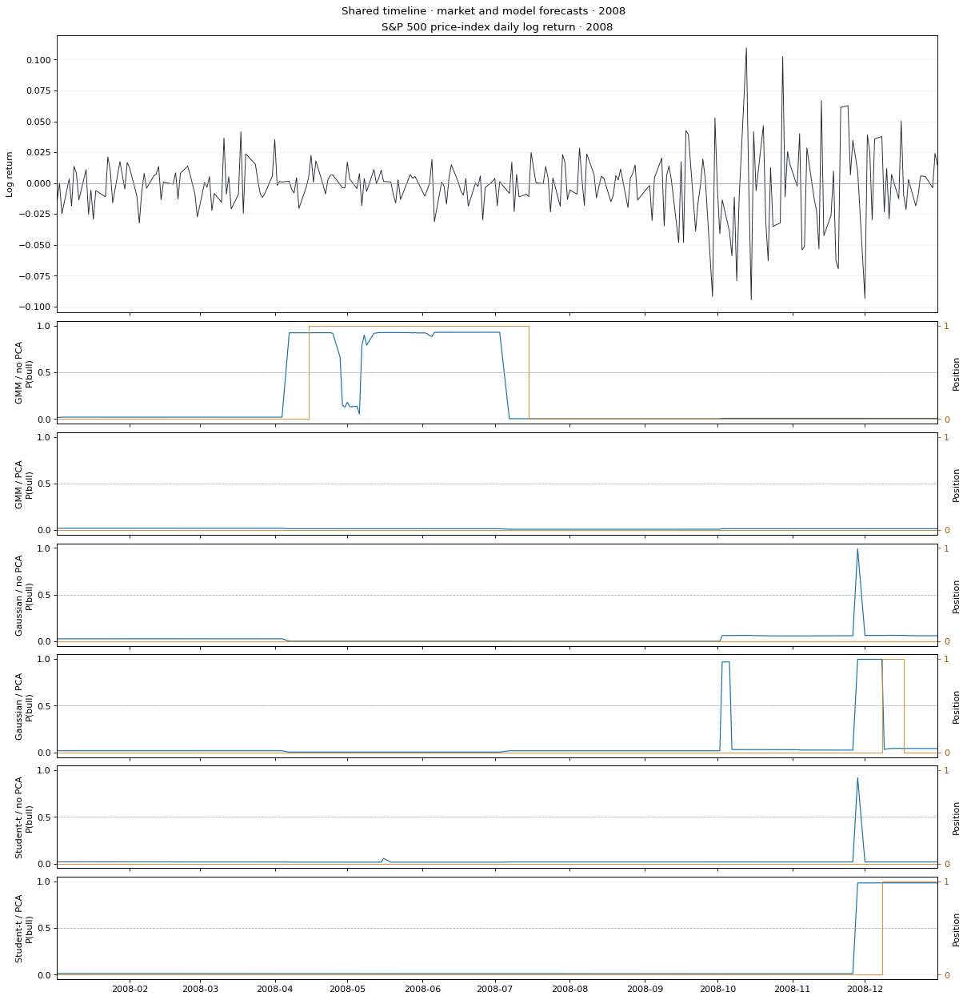

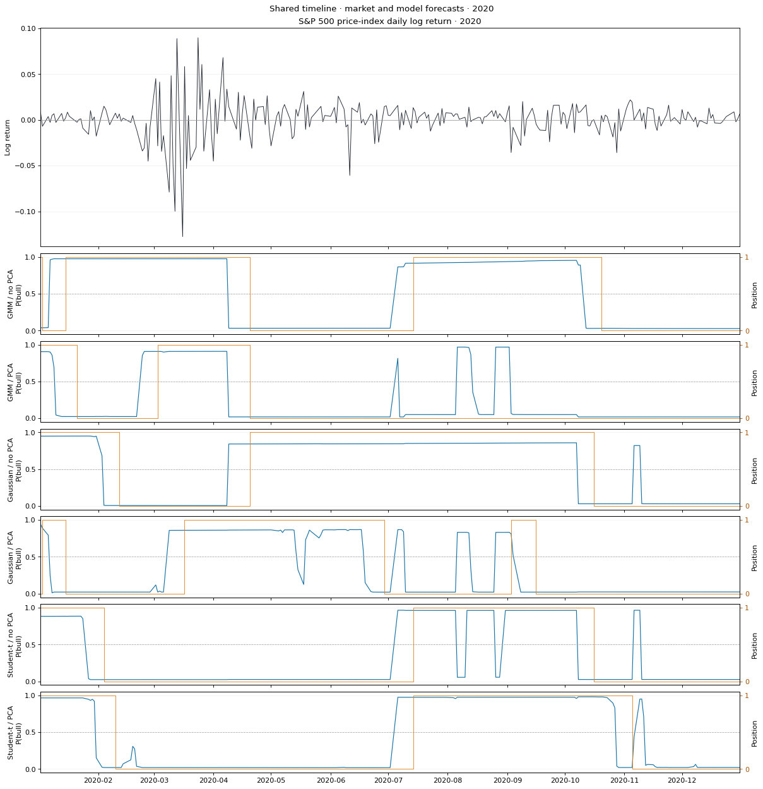

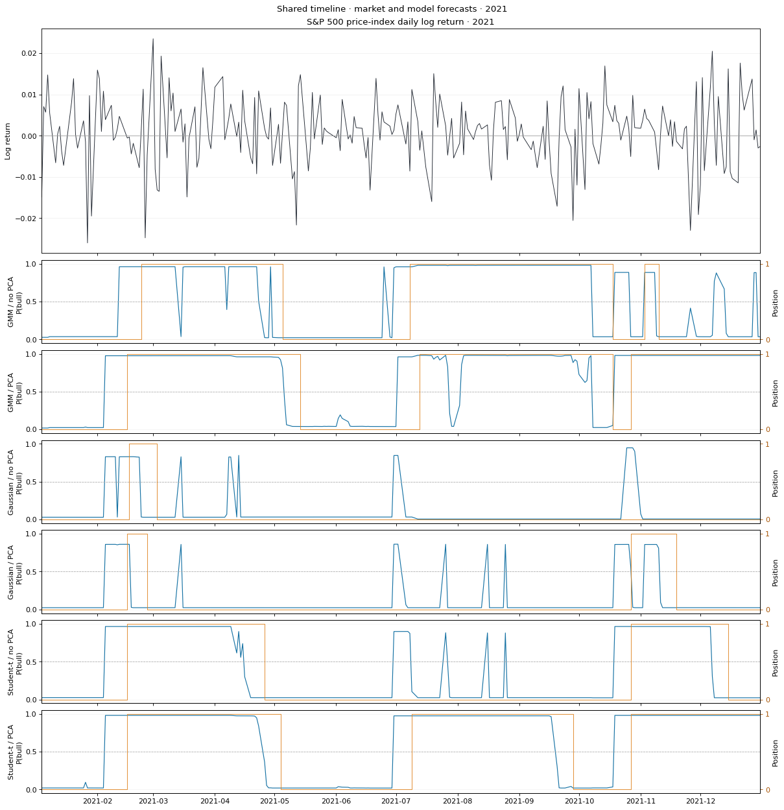

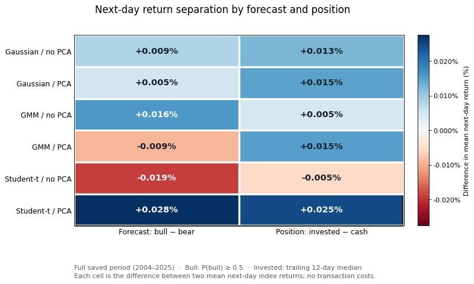

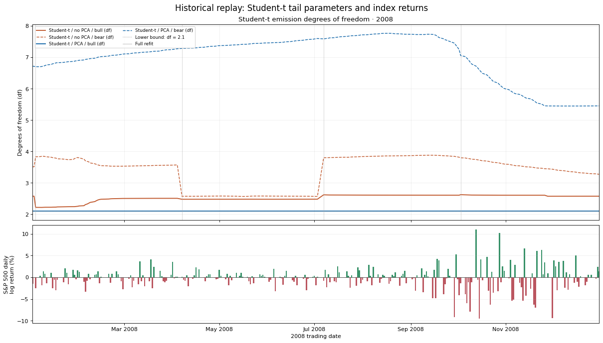

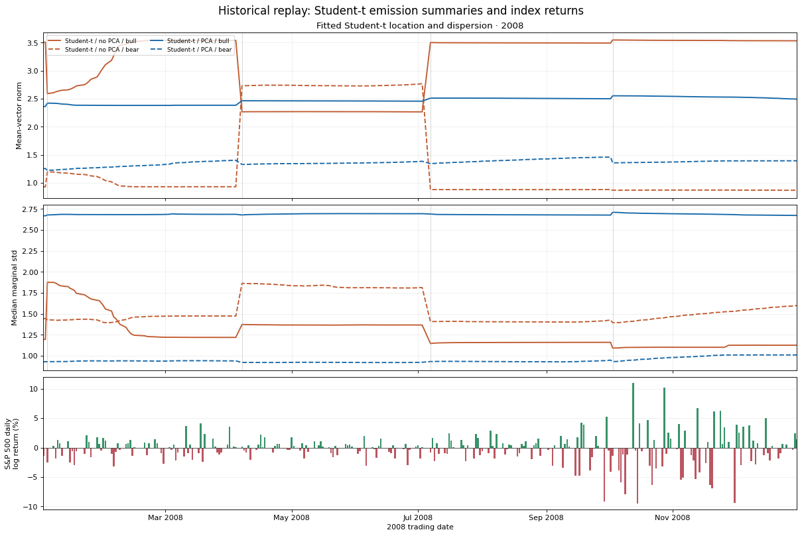

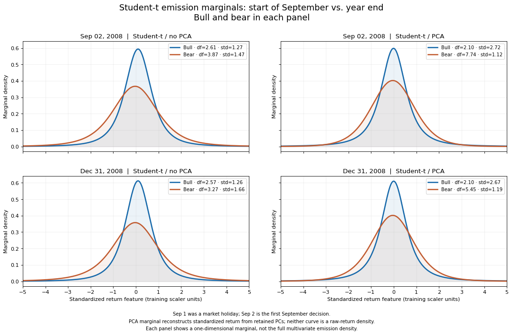

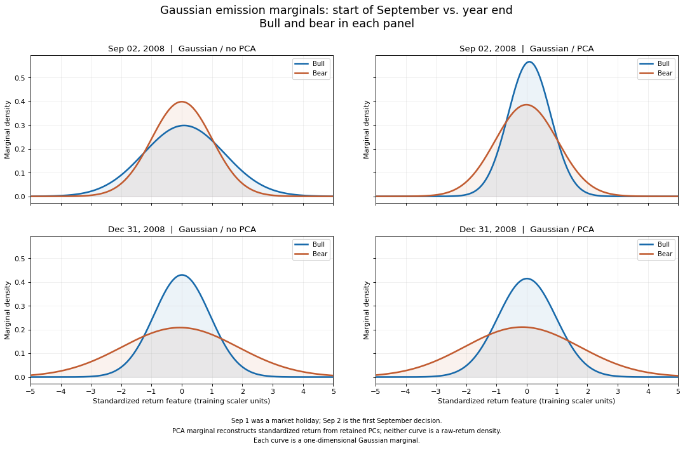

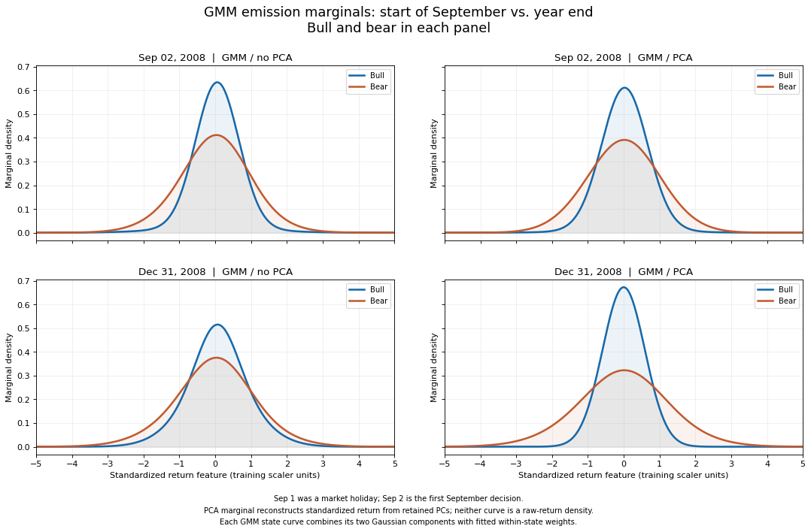
